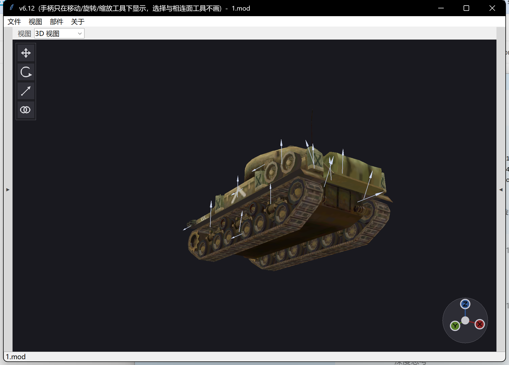

# MODVIEW — Blitzkrieg `.mod` model viewer / editor

[](https://github.com/keongmeng/MODVIEW/releases/latest)
[](LICENSE)

A small desktop tool for the classic RTS **Blitzkrieg** and its mods: open a `.mod` model,
inspect it, tweak it, and write it back — without launching the game.

Written in plain Python (tkinter + PyOpenGL), shipped as a single `.exe`.
Chinese version: [README.md](README.md)



---

## Download

**[⬇ MODVIEW v6.12 — Windows x64 (single exe)](https://github.com/keongmeng/MODVIEW/releases/latest)**

No Python installation needed. Unzip nowhere — just run it.
Drop a `.mod` (or a whole model folder) onto the window to open it.

---

## Features

**View**

- 3D viewport: left-drag to orbit, wheel to zoom, right-drag to pan
- Part outline with `id / name / type / rotation limits`
- `.dds` textures decoded in-process (GDI+, no DirectX SDK required)
- Wireframe / solid / textured modes, AABB box display

**Edit**

- Move / rotate / scale with handles and snapping
- Edit rotation limits, rename parts, separate or join meshes
- Part-ID renumbering — the game pairs `Geometry` with parts by ID, so gaps make parts fly to wrong places
- Global scale / mirror

**Animation**

- Reads the animation clips stored inside a `.mod` and previews them on a timeline
- Writes them back untouched on save (clips are no longer dropped when you re-export)

**Misc**

- XML editor for `<Platforms>` / `<Guns>` / `<RPG>` blocks, with a **syntax check** that reports line and column
- Export to OBJ
- Every `.mod` save goes through a read-back verification (object count, face count, bounding box, clip count)

---

## Run from source

| Requirement | Notes |
|---|---|
| Python 3.8+ | must include tkinter (the official installer does) |
| numpy | `pip install numpy` |
| PyOpenGL | `pip install PyOpenGL` |
| **mod_scene** | the `.mod` reader/writer, **taken from the Blender `mod` add-on** — see below |

```bash
pip install -r requirements.txt
python modview.py path/to/model.mod
```

### About `mod_scene`

`modview.py` looks for a package named `mod` in these places and reuses it as the `.mod` parser:

```
<python dir>/mod
%APPDATA%\Blender Foundation\Blender\{5.2,5.1,5.0,4.5,4.2,4.1,4.0}\scripts\addons\mod
```

So the easiest setup is: install the Blender add-on that imports/exports Blitzkrieg `.mod`
(usually shipped with modding toolkits), and this app picks it up automatically.
You can also copy that `mod` folder next to `modview.py`.

> `mod_scene` is **not** part of this repository — it belongs to the Blender add-on and its author.

### Build a standalone exe

```bash
pip install pyinstaller
python -m PyInstaller MODVIEW.spec
# result: dist/MODVIEW.exe
```

`build.bat` does both steps on Windows.

---

## Layout

```
modview.py     main app: UI, editing logic, export pipeline
glviewport.py  OpenGL viewport: rendering, picking, gizmo, textures
mod_id.py      part-ID helpers (renumber, collision checks)
i18n.py        Chinese / English strings
MODVIEW.spec   PyInstaller build config
```

---

## Known limitations

- Windows only (uses GDI+ for DDS decoding and `ctypes` calls into `user32`)
- Animations can be previewed and written back as a whole; there is no per-keyframe editing
- AABBs are read-only

---

## License

MIT — see [LICENSE](LICENSE).
`mod_scene` (the Blender add-on) is not covered by this license.
